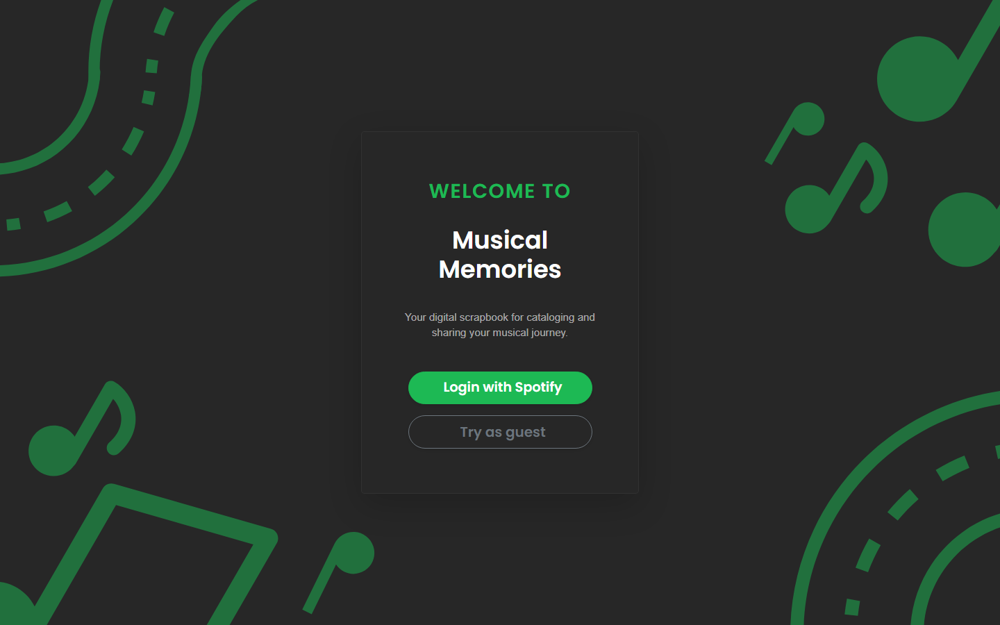
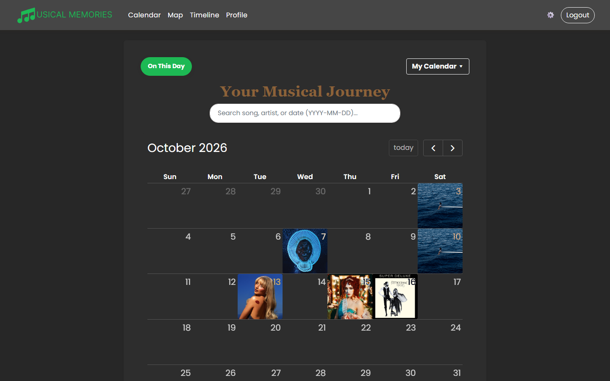
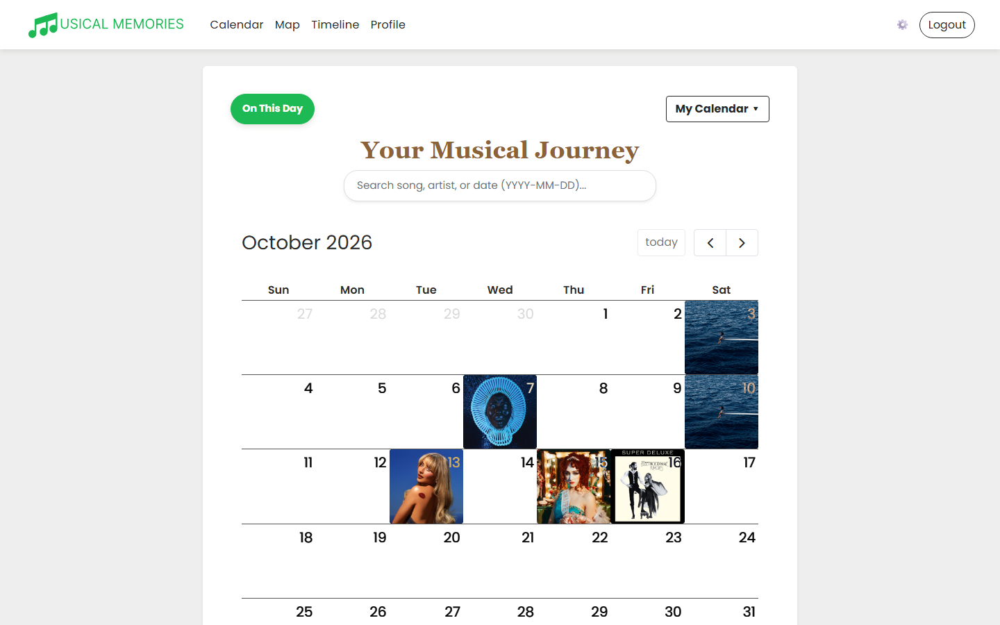
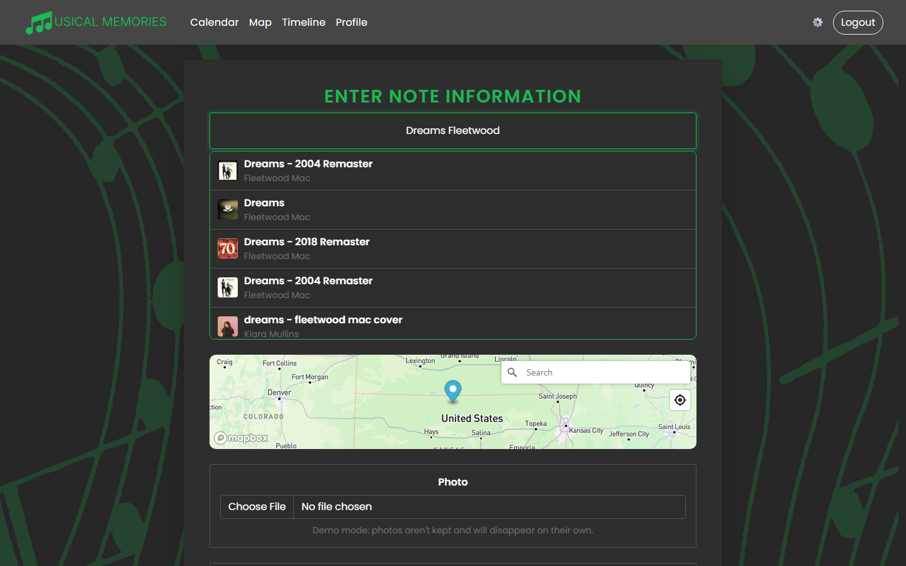
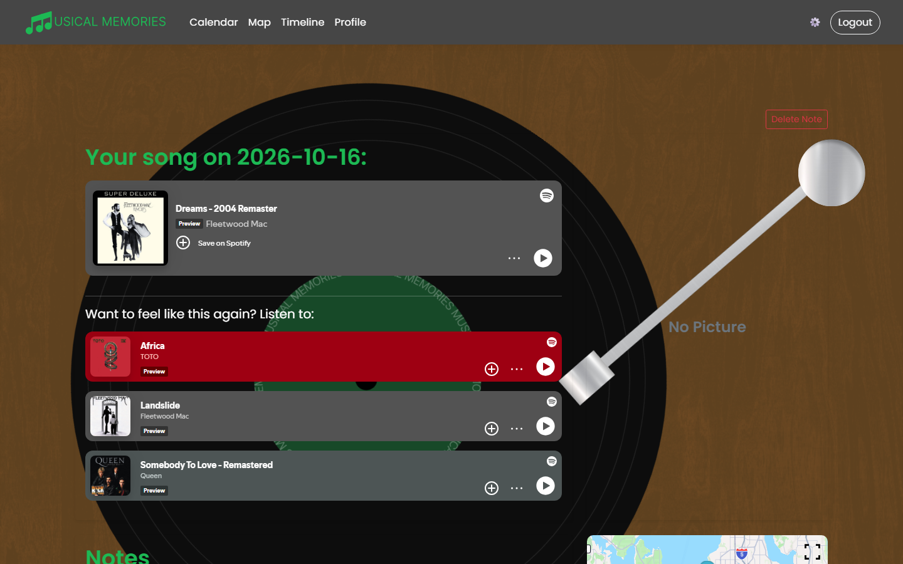
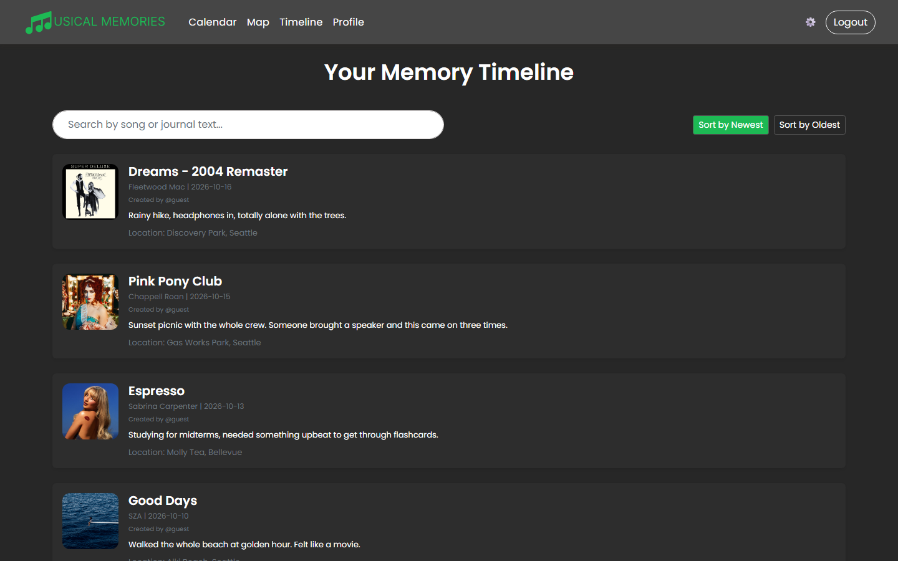
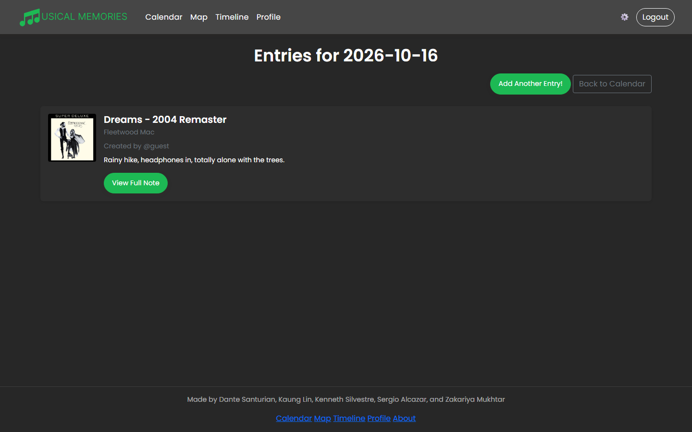
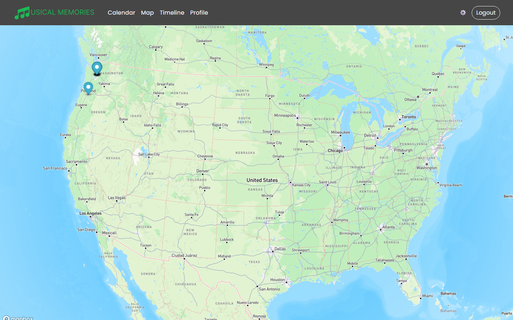
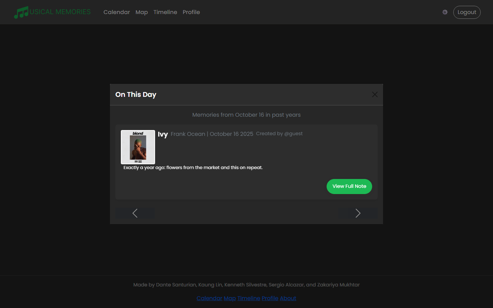
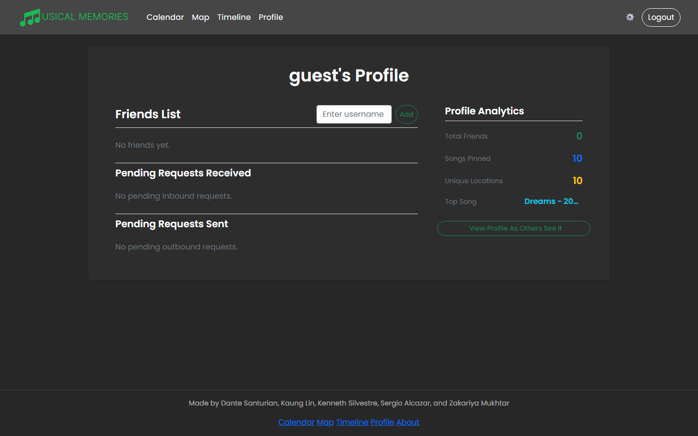

# Musical Memories

Musical Memories is a Flask-based web application that lets users connect music to meaningful moments.
Users are able to log  in with Spotify, search for songs, save songs as memories on a calendar, add journal notes, attach location and photos, and revisit memories through calendar, timeline, map, and "On This Day" views.


## Features 

- Spotify OAuth login
- Spotify song search
- Save songs as calendar memories
- Add journal notes, locations, and optional photos
- Multiple entries per day
- Personal calendars
- Shared calendars with join codes
- Timeline view
- Map view for location-based memories
- "On This Day" feature for past memories
- Friend requests and user profiles
- Gemini-powered song recommendations
- Reduced motion accessibility option
- Dark mode and Light mode options

## Tech Stack

### Frontend
- HTML
- CSS
- JavaScript
- Boostrap
- FullCalendar.js
- Mapbox

### Backend
- Python
- Flask
- Flask-WTF
- SQLAlchemy
- SQLite

### APIs
- Spotify Web API
- Gemini API
- Mapbox API

## How the App Works

Users log in with Spotify and can create musical memories tied to a specific date. Each memory can include a song, artist, album image, journal text, location, and photo.
Musical Memories supports multiple entries per day and shared calendars.

## Deploying

The app runs on Render (web) with a Neon Postgres database. Visitors can click "Try as guest" without a Spotify account; logging out deletes the guest's data. To deploy or redeploy, run the setup wizard from the repo root:

```
bash scripts/deploy-wizard.sh
```

It walks you through the Spotify, Mapbox, Gemini, Neon and Render dashboards, writes local values to `.env`, and checks the live site at the end.

## Demo

Click **Try as guest** to explore without a Spotify account.



### Calendar
Each day you save a song shows its album art.

| Dark mode | Light mode |
|---|---|
|  |  |

### Saving a memory
Search Spotify, pick a song, drop a pin, and write a note.



### Note page
Play the song, read the note, and get Gemini-powered recommendations for songs with the same feel.



### Timeline and day view

| Timeline | Entries for a day |
|---|---|
|  |  |

### Map
Every memory with a location becomes a pin.



### On This Day and Profile

| On This Day | Profile |
|---|---|
|  |  |


